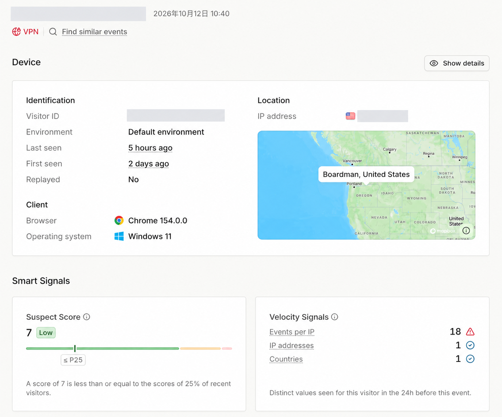
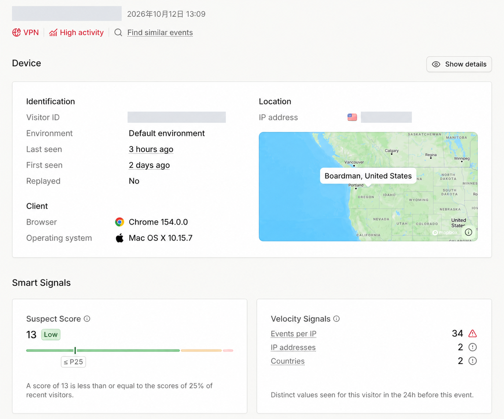

# 在 Linux 无头环境下仿真桌面指纹：Chrovia 的内核级方案与实测

[English](../en/linux-headless-web-crawling-with-chrovia.md)

在自动化网页数据采集与爬虫架构中，Linux 服务器是绝大多数团队的默认基础设施——部署成本低、容器化方便、并发资源易于弹性扩缩。为了节省内存与 CPU 开销，大规模采集通常以 Headless（无头）模式运行。

然而，这也带来了最棘手的工程问题：**现代反爬与风控系统对 Linux 和 Headless 运行环境极度敏感。**

为了防止被目标网站拦截，通常的做法是将浏览器伪装成日常用户的 Windows 或 macOS 桌面环境。但如果只是在应用层用脚本打补丁，往往漏洞百出。Chrovia 在 Chromium 内核层实现了跨平台的桌面指纹仿真能力，让开发者在 Linux 服务器上以 Headless 模式运行爬虫时，无需编写繁杂的注入脚本，即可直接获得与真实桌面环境一致的浏览器特征。

## 为什么在 Linux 上伪装桌面指纹容易失效？

很多团队尝试过在 Playwright 或 Puppeteer 中注入 `stealth` 脚本，手动覆盖 `navigator.userAgent` 或修改某些原型链属性。这种方式在简单的规则检测中或许有效，但在面对成熟的商业级指纹算法（如 Fingerprint.com、Cloudflare Turnstile、DataDome 等）时，很容易因为细节破绽被标记为异常流量。

这些破绽通常出现在几个深水区：

1. **执行上下文穿透（Web Worker 泄漏）**  
   注入脚本通常只能作用于主文档的 window 和 DOM 环境。一旦网页动态创建了 Dedicated Worker、Shared Worker 或 Service Worker，这些独立运行的后台线程无法被常规的 DOM 脚本无缝覆盖。反爬脚本只需在 Worker 内部读取一次 `navigator.platform` 或 `navigator.userAgent`，真实的 Linux 底层便会暴露，主线程与 Worker 之间立即产生指纹撕裂。

2. **参数东拼西凑带来的自相矛盾**  
   如果靠随机算法拼凑参数，极易组合出“在真实世界中根本不存在的设备”。例如，声称自己是 macOS 却暴露了 DirectX 图形接口；声明了高分辨率视口，却对应着低端手机的 GPU 算力；或者指定了 Windows 11 平台，内部却缺少 Windows 的核心系统字体。这些互斥的特征在现代风控系统的规则引擎中是典型的危险信号。

3. **图形管线与排版度量（Font Metrics）的真实渲染差异**  
   指纹检测不仅看属性声明，更会主动绘制图形和文字：
   - **Canvas 与 WebGL**：着色器编译特性、浮点运算精度、图形扩展列表以及像素读回，在 Linux 的虚拟驱动（如 Mesa llvmpipe、SwiftShader）与 Windows 的 Direct3D 或 macOS 的 Metal 之间存在肉眼不可见但哈希截然不同的计算差异。
   - **字体渲染引擎**：Linux 的 FreeType 与 Windows 的 ClearType、macOS 的 CoreText 在文本包围盒尺寸、字间距和笔画平滑度上有独特的渲染算法。即便在 Linux 上强行安装对应字体，细微的几何度量依然可能出卖宿主环境。

## 从成套样本生成设备画像

针对参数矛盾的问题，Chrovia 摒弃了无序拼接随机属性的做法，采用**成套真实样本驱动**的设备画像生成机制。

Chrovia 从大量真实桌面环境中提取协调一致的基线样本。每一次生成的浏览器配置，都是一个在逻辑上自洽的完整设备整体：

- **全局协同**：系统声明、字体集、系统颜色偏好、语音合成引擎、键盘布局、屏幕分辨率与色深协同匹配；
- **图形与算力匹配**：GPU 参数、着色器特性以及音视频编解码能力与对应的设备型号及操作系统严格对齐；
- **平台专属约束**：针对 macOS 环境，严格遵循具体机型（Model ID）与系统版本的发布规格进行约束，避免出现跨架构或超前版本的不合理组合。

开发者只需指定目标平台（例如 Windows 11 或 macOS），Chrovia 就会生成整套经过校验的指纹配置，同时允许开发者根据具体的采集任务调整时区、语言和地理位置等业务参数。

## Chromium 内核层仿真，无需外挂注入脚本

Chrovia 的指纹仿真能力直接内置在 Chromium C++ 内核中，而不是在网页加载时动态注入 JavaScript。

这种架构带来了几个关键优势：

- **全局一致的运行上下文**：无论是主文档、iframe，还是各种 Web Worker 和扩展后台，内核级仿真在进程和上下文创建之初即已生效，从源头上消除了多线程环境下的指纹脱节；
- **干净的原型链与 API**：所有接口属性与原生对象表现完全一致，没有 monkey-patch 留下的 `toString()` 异常、属性描述符偏差或原型链污染，无法被检测脚本通过代码反射反查；
- **底层渲染微调**：深入处理 Canvas 像素生成、WebGL 着色器计算响应、WebGPU 特性、字体排版度量以及底层数学浮点精度，确保深层渲染与计算特征契合目标桌面平台。

这免去了开发者维护复杂反检测注入脚本的精力，也避免了随着 Chromium 版本升级注入脚本频繁失效的维护负担。

## 与 Playwright 无头采集流程无缝集成

在实际工程落地中，开发者不需要重写现有的爬虫架构。Chrovia 对基于 CDP（Chrome DevTools Protocol）的主流自动化工具保持完全兼容。

通过配套工具生成指纹配置和启动参数后，即可直接用 Playwright 或 Puppeteer 驱动 Chrovia：

- **开箱支持 Headless 模式**：直接在 Linux 服务器以无头方式启动；
- **环境隔离与数据复用**：支持为不同爬虫任务指定独立的用户数据目录（`--user-data-dir`），会话 Cookie 与本地存储平滑持久化；
- **标准的自动化交互**：页面导航、等待选择器、交互点击、数据提取以及整页截图等既有逻辑无需任何改动。

## Linux Headless 实测结果

我们在云端 Linux 服务器（Ubuntu 环境）上，以 Headless 模式运行 Chrovia，分别仿真 Windows 和 macOS 桌面环境，并在业内严苛的商业级指纹与风控平台 Fingerprint.com（Pro 版本）上进行了实测检测。

检测结果如下：

| 仿真目标 | 平台识别结果 | Suspect Score（可疑评分） | 风险评级 |
| :--- | :--- | :--- | :--- |
| **Windows** | Windows 11 (Chrome 154.0.0) | **7** | **Low** |
| **macOS** | Mac OS X 10.15.7 (Chrome 154.0.0) | **13** | **Low** |

### 实测结果分析

在 Fingerprint.com 的检测中，两组测试均成功被识别为对应的桌面系统，且 Suspect Score 均处于极低的风险区间（7 分和 13 分，处于低于或等于 75% 访客的低风险评分段）。

需要客观指出的是，**这 7–13 分依然是因为代理 IP 与高频访问行为导致的，而非浏览器指纹本身存在破绽**：
- **网络与频次标记**：从控制台截图中可以看到，系统明确打出了 `VPN` 和 `High activity`（高频访问）标签。这是由于测试实例运行在云数据中心、使用了机房网络出口，并在短时间内进行了密集的连续请求，从而触发了风控系统的网络与速率告警。
- **设备指纹未见异常**：在浏览器内核指纹、硬件参数与渲染一致性维度上，没有触发任何与 Headless、Linux 或指纹篡改相关的警报。

这也明确了进一步降低风控分数的优化方向：
如果接入**更优质的纯净住宅 IP**，并在网络代理层**匹配与所模拟操作系统一致的 TCP/IP 指纹**（避免出现浏览器声明为 Windows/macOS、底层 TCP SYN 握手包却暴露出 Linux 内核协议栈的矛盾），同时**合理控制访问频率与请求间隔**，Suspect Score 还会进一步降低。

在实际的网页爬虫与数据采集业务中，成功率取决于多层防御的协同破解：**浏览器内核指纹真实度**、**网络出口 IP 纯净度与 TCP/IP 协议栈匹配度**，以及**访问行为轨迹控制**。Chrovia 在内核层彻底解决了浏览器指纹与执行环境一致性问题；开发者只需搭配合适的网络资源与调度策略，即可在 Linux 上稳定运行高可靠的自动化采集流水线。

---

[了解 Chrovia SDK](https://console.getchrovia.com/products/sdk) · [阅读 SDK 说明文档](../../README.md) · [联系我们](mailto:support@getchrovia.com)
